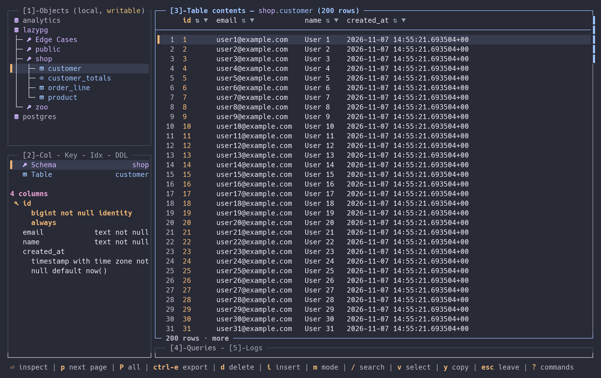
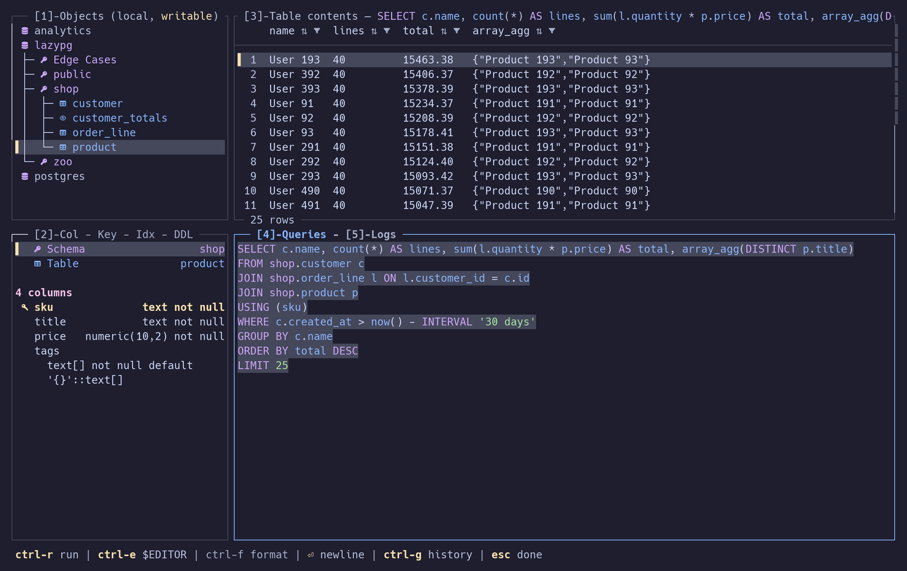
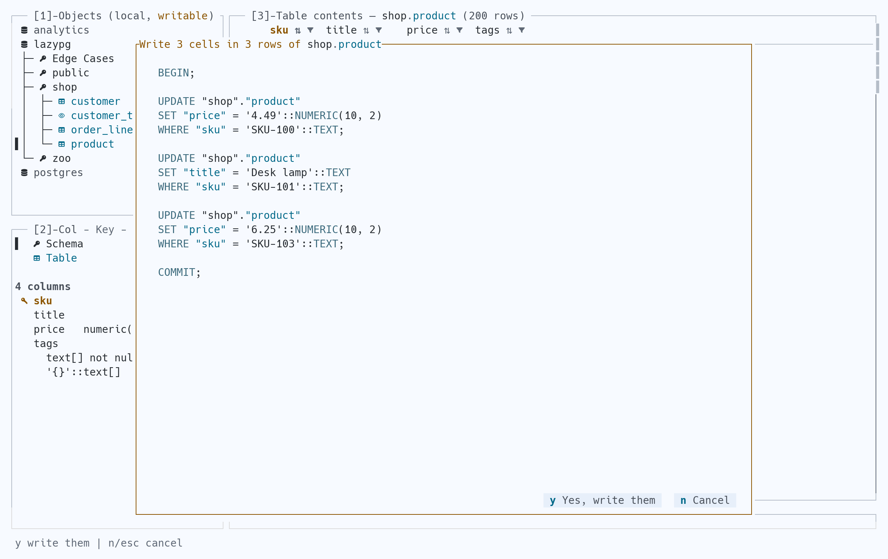

# LazyPg

**Your Postgres database, a few keystrokes away.**

LazyPg is a terminal UI for PostgreSQL. Browse databases, schemas and tables,
see columns, keys, indexes and DDL next to the rows, run SQL, and edit data
behind a preview of the statements it will send. Vim-style keys and a
lazygit-style panel layout.



- **See the schema.** Every database on the server, its schemas, tables,
  views and materialized views; columns, primary and foreign keys, indexes
  and DDL for the selected table.
- **Write SQL with context.** Schema-aware completion, highlighting,
  formatting, `$EDITOR`, per-connection history and a session log.
- **Explore and export.** Paging, local sort and filter, full-value
  inspection, clipboard yanks, CSV/JSON export, rows copied as `INSERT`s.
- **Control writes.** Read-only by default and enforced by the server. Cell
  edits, inserts and deletes are previewed as one `BEGIN; …; COMMIT;` before
  they run; a transaction you open yourself is tracked and shown.

<details>
<summary>Queries and edits — two more themes</summary>

**Run a query · Catppuccin Mocha**



**Preview edits before they run · Quill Light**



</details>

## Install

PostgreSQL 14 and later. Linux and macOS; on Windows, use WSL. A true-colour
terminal works best; icons need a Nerd Font, or set `icons = false`.

### Homebrew

```sh
brew install ike-forge/tap/lazypg
```

### From source

Needs Git, a C compiler (for `aws-lc-rs`) and Rust 1.97.1:

```sh
git clone https://github.com/ike-forge/lazypg.git
cd lazypg
rustup toolchain install 1.97.1
cargo +1.97.1 install --path crates/lp-app --locked
```

With [mise](https://mise.jdx.dev/), `mise install` provides the toolchain,
then `cargo install --path crates/lp-app --locked`.

## Get started

The first launch writes a commented `~/.config/lazypg/config.toml`. Add a
connection, then:

```sh
lazypg --connection dev
```

Without `--connection` or `default_connection`, LazyPg opens the connection
picker. `Enter` unfolds a schema or opens a table, `4` opens the SQL editor,
`Ctrl-r` runs the statement under the cursor, `?` lists every command.

## Configuration

Layers, later wins: built-in defaults → `~/.config/lazypg/config.toml`
(`$XDG_CONFIG_HOME/lazypg/config.toml` if set) → the nearest `.lazypg.toml`
in the working directory or an ancestor → `--config <path>`.
`--connection <name>` overrides `default_connection`.

```toml
theme = "catppuccin-mocha"
default_connection = "dev"

[[connections]]
name     = "dev"
host     = "127.0.0.1"          # or a socket directory: "/var/run/postgresql"
port     = 5432
database = "orders"
user     = "ana"
password = { env = "ORDERS_PW" }  # or "literal", or { file = "~/.secrets/orders" }
sslmode  = "verify-full"        # disable | prefer | require | verify-ca | verify-full
posture  = "read-only"          # read-only | writable | protected

[[connections]]
name = "staging"
url  = "postgresql://svc@staging.internal:5432/orders?sslmode=require"
```

Every key but `name` is optional and falls back as psql's does: `PGHOST`,
`PGPORT`, `PGDATABASE`, `PGUSER`, `PGPASSWORD`, `PGSSLMODE`, then libpq's
default. Without a password, `~/.pgpass` (or `PGPASSFILE`) is read; it is
ignored if group or others can read it.

`url` replaces host, port, database, user, password and sslmode, and cannot
be combined with them. A JDBC URL works; driver-only parameters are reported
and ignored. `sslrootcert`, `sslcert` and `sslkey` take PEM paths; without
`sslrootcert` the system roots are used.

Postures:

- `read-only` (default): no edits, inserts, deletes or drops, and the session
  runs with `default_transaction_read_only = on`, so Postgres refuses any
  write that gets through.
- `writable`: writes after a preview; drops and deletes ask `y`/`n`.
- `protected`: writable, but a drop or truncate needs the object's name typed.

Dropping a schema always needs its name typed, and never cascades.

The [config reference](crates/lp-outbound/src/config/example.toml) covers
themes, custom themes, layout, grid, history, driver timeouts and export.
`Ctrl-t` saves the chosen theme.

## Key bindings

The bottom bar shows what the focused panel takes; `?` lists all of it.

| Keys | Action |
| --- | --- |
| `1` / `2` / `3` / `4` / `5` | Objects / Structure / Table contents / SQL editor / Logs |
| `Tab` / `Shift-Tab` · `[` / `]` | Next / previous panel · previous / next tab |
| `h` `j` `k` `l` / arrows | Move, fold and unfold |
| `g` / `G` · `Ctrl-u` / `Ctrl-d` | First / last row · page up / down |
| `/` · `n` / `N` | Search the panel · next / previous match |
| `Enter` | Open a table; inspect a row or cell |
| `m` · `v` · `y` | Cycle row / column / cell mode · select rows · copy |
| `s` / `f` / `c` | Sort / filter / clear filter, in column mode, on fetched rows |
| `p` / `P` | Fetch the next page / every page |
| `Y` | Copy the selected rows as `INSERT` statements |
| `Ctrl-e` | Export rows; open `$EDITOR` from the SQL editor |
| `Ctrl-r` · `Ctrl-f` · `Ctrl-g` | Run the statement · format the buffer · query history |
| `e` · `i` · `d` | Edit a cell · insert a row · delete rows or drop an object |
| `x` | In the inspector: stage `NULL` |
| `Ctrl-s` | Preview and commit staged edits |
| `Ctrl-o` / `Ctrl-t` | Connection picker / theme picker |
| `Ctrl-c` | Cancel running queries |
| `Esc` / `q` | Back out one step / quit |

In the SQL editor printable keys are text; `Esc` leaves it.

## Project

Pre-1.0. Query plans and server operations are on the
[roadmap](docs/vision.md#7-roadmap). Bugs and ideas:
[issues](https://github.com/ike-forge/lazypg/issues).

Development: [docs/development.md](docs/development.md) (fixture database,
tasks) and [docs/architecture.md](docs/architecture.md).

Released under the [0BSD license](LICENSE). The Catppuccin, Solarized and
Dracula themes use their authors' palettes; see the
[third-party notices](THIRD-PARTY-NOTICES.md).
